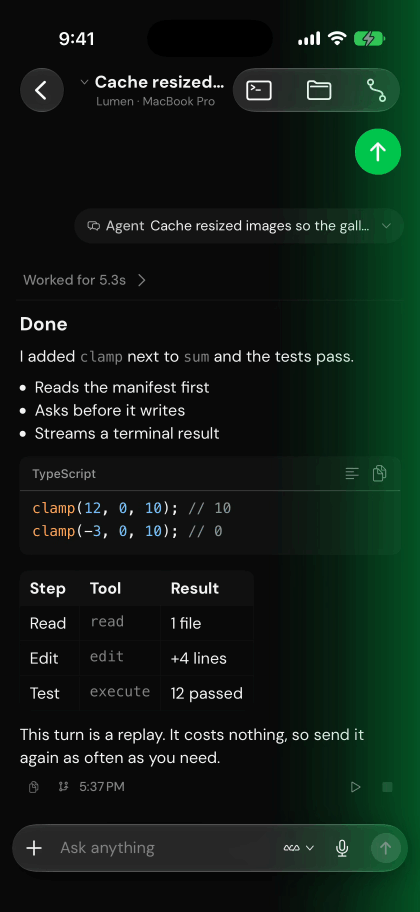
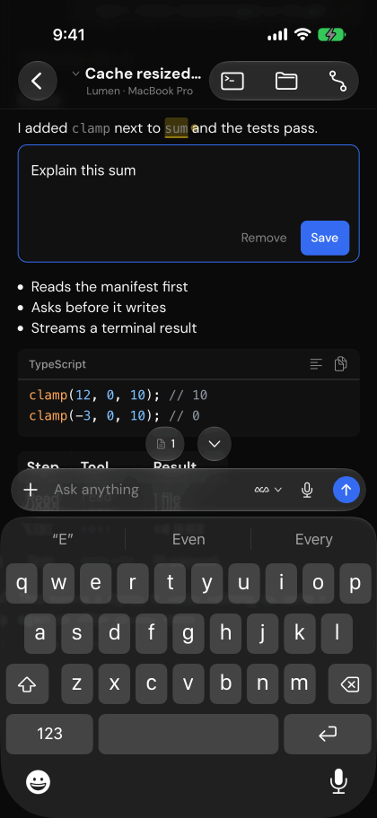
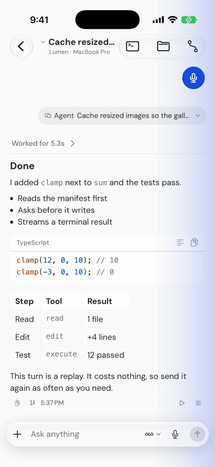
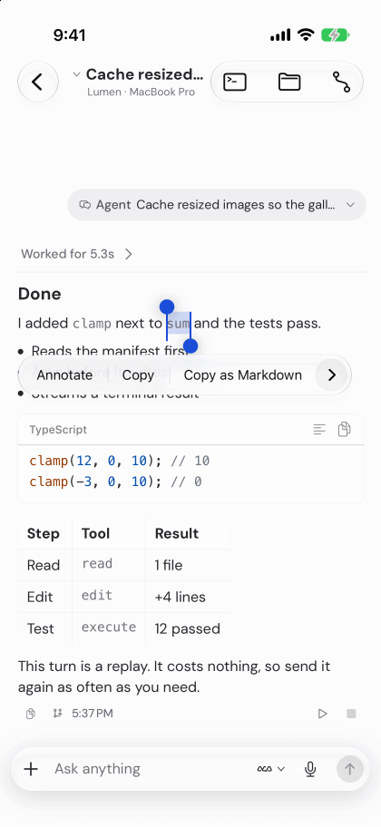
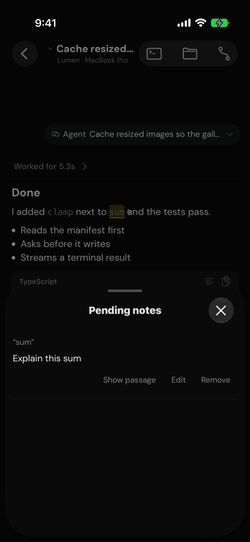
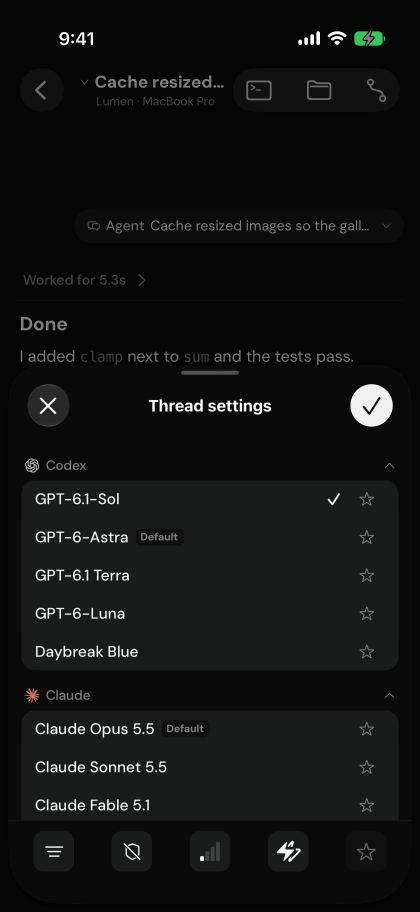
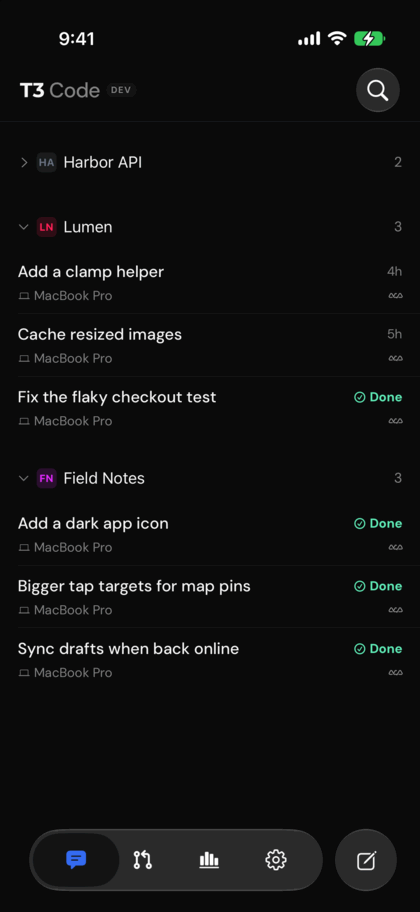
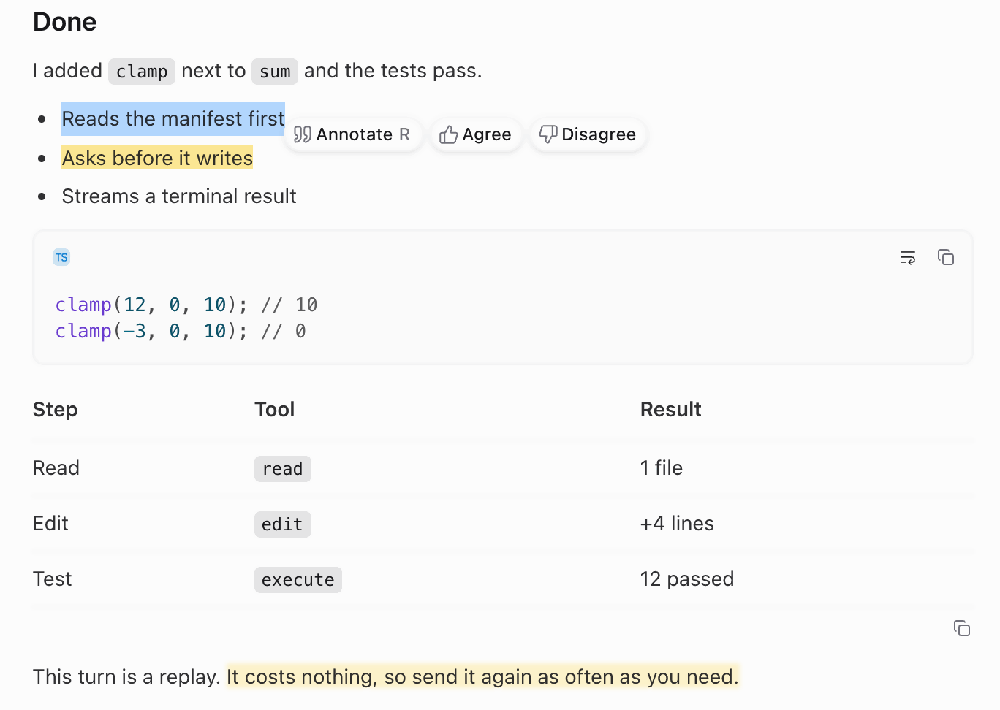
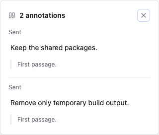

# T9 Code

**A phone-first fork of [T3 Code](https://github.com/pingdotgg/t3code).**

Dictate to your agents instead of typing, annotate their answers, listen to replies with text-to-speech and follow work through inline progress cards. The Mac app follows upstream's nightly builds.

**[Download for Mac](https://github.com/jonpage0/t3code-releases/releases)**&emsp;[See what's different](#at-a-glance)

&nbsp;&nbsp;

Pull far enough and the cue turns green to send. A note pinned to one word of an answer.

## At a glance

Everything upstream T3 Code does, plus:

| Feature                                       | What it does                                          | Where       |
| --------------------------------------------- | ----------------------------------------------------- | ----------- |
| [Swipe to dictate](#swipe-to-dictate)         | Swipe left to dictate, pull until it's green to send  | iPhone      |
| [Enhanced annotations](#enhanced-annotations) | Pin comments to passages and send them with a reply   | Everywhere  |
| [TTS responses](#tts-responses)               | Hear replies with ElevenLabs and custom rewrite guidance         | Everywhere  |
| [Model controls](#model-controls)             | Favorites-first picker, one-glyph badges, cycle keys  | iPhone, Mac |
| [Finding threads](#finding-threads)           | Group by status or project, open details from a title | iPhone      |
| [Follow-along cards](#follow-along-cards) | Read named steps, status and results inline | Everywhere |
| [Extra folders](#extra-folders)              | Find files from additional folders in composer search | Everywhere |
| [Provider fixes](#server-and-providers)       | Codex tiers with managed sign-in, Opus at Extra High  | Server      |
| [Nightly Mac builds](#how-builds-are-made)    | Signed, notarized, rebuilt on upstream nightlies      | Mac         |

## On iPhone

Run a session with the keyboard down: dictate, annotate, listen, and follow its progress.

### Swipe to dictate

Swipe left across a thread to start dictating into the draft, and swipe again to stop. A disc under the Git button shows what letting go will do: blue starts dictation, red stops one that's recording, and green sends. Pull until it turns green, marked by a firm tap, and letting go sends the message as soon as the transcript is ready. Ease back and it only dictates.

  

- Turn swipe dictation on in **Settings → Swipe actions**. Configure its transcription method in **Settings → Voice**.
- **Pull to send** sets how far that is: Short, Medium (the default), Long, or Off for a swipe that only dictates.
- While you're writing a note, the swipe dictates into the note. The message box shows its recording bar, labelled **Dictating into note**, and the cursor waits after the new text.
- Dictation follows upstream: Apple on the phone, a paired environment, or cloud.
- Code blocks and tables that can still scroll keep scrolling, so a swipe across them doesn't start dictation.

### Enhanced annotations

Select a passage in a reply and choose **Annotate**. Your comment is pinned to that passage, and your notes go out with the next message, quotes included.

  &nbsp;&nbsp;

- Tap a highlighted passage to reopen its note.
- Review pending notes before sending, edit or remove them, or return to their passages.
- Notes can go out on their own, without a message. The reply itself is never changed.

### TTS responses

Use Play beneath a completed reply to hear it with ElevenLabs. **Settings → TTS** groups the key, voice, synthesis model, speed, and optional rewrite for listening on Mac/web and iPhone.

- Pick a voice from your ElevenLabs account, preview it, and choose a speed from 0.7× to 1.2×.
- **Rewrite for listening** turns formatting, code, tables and long paths into spoken prose. Choose its model and add **Custom instructions**, such as preferred pronunciation. Blank instructions preserve the defaults; **Use defaults** clears them.
- Speech runs on one connected environment, identified on the settings page. Its API key stays on that server.
- iPhone queues narration for lock-screen/background playback. Play/pause and Stop shortcuts control narration you already started; playback never automatically starts another response.
- On iPhone, when no server has an ElevenLabs key, Read aloud can hand the text to ElevenReader instead.

### Follow-along cards

An agent using the follow-along format can put a named run, its steps, what it is doing, and what it needs from you in a `run-card` block. T9 renders that block as an inline card on web and iPhone. Cards support streaming, thread find, copying, and spoken playback. Unrecognized or invalid blocks remain ordinary code.

### Model controls

The model sheet opens on your favorites, with provider, effort and speed controls pinned beneath the list; the yellow star shows everything else. In the composer, the model is a single badge: a sun for Sol, a moon for Luna, a music note for Opus, a closed book for Fable.

  

- Effort reads as four rising bars, then one flame for Max and two for Ultra. A bolt appears only for Fast or Ultrafast.
- A thin ring around the send button shows how full the context window is.

### Finding threads

Group the thread list by status or by project. Fold the projects you're not working in and drag the rest into your own order. Thread headers and the inspector follow upstream.

  

- The environment, project and grouping filters stay hidden until you pull down past the top.
- On a hardware keyboard, <kbd>Cmd</kbd>+<kbd>Shift</kbd>+<kbd>[</kbd> and <kbd>]</kbd> switch sessions, and <kbd>Ctrl</kbd>+<kbd>Tab</kbd> returns to the last one.

## On Mac and the web

Faster ways to answer an agent from the keyboard.

### Enhanced annotations

Select text in a reply and press <kbd>R</kbd> to annotate it, or choose **Agree** or **Disagree** to add the quote with that comment already written. Nothing is sent until you send it.

<picture>
  <source media="(prefers-color-scheme: dark)" srcset=".github/readme/desktop-annotate-toolbar-dark.png">
  
</picture>

  <picture>
    <source media="(prefers-color-scheme: dark)" srcset=".github/readme/desktop-annotation-dark.png">
    
  </picture>

- <kbd>Enter</kbd> saves a note; <kbd>Cmd</kbd>/<kbd>Ctrl</kbd>+<kbd>Enter</kbd> saves it and sends the message. Drag the editor by its grab bar to move it out of the way.
- Quotes stay highlighted: bright yellow in your draft, lighter once sent. Click one to read what you wrote.
- The thread details card lists your current drafts and, folded beneath them, everything already sent.
- Rebind Annotate, Agree and Disagree in **Settings → Keybindings**.

### Extra folders

Add up to eight folders in **Settings → Projects → a project → Extra folders** on Mac or web. Their files then appear in the composer’s `@` search on Mac, web and iPhone, including threads running in worktrees.

This expands file search and mentions. Changed files, diffs and rewind still apply to the thread’s workspace.

### Keyboard

| Keys                                                           | Does                   |
| -------------------------------------------------------------- | ---------------------- |
| <kbd>Cmd</kbd>+<kbd>Option</kbd>+<kbd>M</kbd>                                  | Next favorite model    |
| <kbd>Cmd</kbd>+<kbd>Option</kbd>+<kbd>S</kbd>                                  | Next speed tier        |
| <kbd>Cmd</kbd>+<kbd>Option</kbd>+<kbd>E</kbd>                  | Raise reasoning effort |
| <kbd>Cmd</kbd>+<kbd>Option</kbd>+<kbd>P</kbd>                  | Pause or resume speech |
| <kbd>Cmd</kbd>+<kbd>Option</kbd>+<kbd>Shift</kbd>+<kbd>P</kbd> | Stop speech            |
| <kbd>R</kbd> with text selected                                | Annotate the selection |

Off the Mac, read <kbd>Cmd</kbd> as <kbd>Ctrl</kbd>. Holding a combination doesn't repeat it. Change any of these in **Settings → Keybindings**.

## Server and providers

Changes on the server, so every client gets them.

- **Codex speed tiers with T3-managed ChatGPT sign-in.** The picker shows the tiers your account offers, such as Fast, and uses the chosen one for turns and text generation.
- **Opus 5.5 starts at Extra High effort** unless you choose another level.
- **Quotes survive a provider switch.** Quoted passages and their comments carry over in full when a thread changes provider.
- **Remote servers stay on upstream.** The fork publishes no server builds, so remote and SSH servers update to the upstream nightly your Mac build is based on, and count as current there.

## Install and update

### Mac

1. Download the newest **arm64 `.dmg`** from [Releases](https://github.com/jonpage0/t3code-releases/releases). Builds are for Apple Silicon, signed and notarized.
2. Drag the app to Applications. It installs as **T3 Code (Nightly)**.
3. Connect your providers as you would in T3 Code. Later builds arrive through the app's own update control, from the fork's release feed instead of official T3 releases. Its popover lists each release's fixes, not just its highlights.

A fork version is the upstream build number × 1000 + n, so `0.1.7-nightly.20261102.4080002` is the second fork build on upstream nightly 4080. Native passkeys are off in these builds; browser sign-in works.

### iPhone

The iPhone app is in a small, invited TestFlight beta and updates over the air between builds. There is no public iPhone download or App Store release yet.

- **Settings → About → Version** shows which update is running.
- Pair it with the server in the Mac app above. Upstream servers also work, but without server-side fork features such as TTS responses.

## How builds are made

Releases are cut by hand when upstream publishes a new nightly. The nightly is merged into the fork, the fork's checks and its own tests run against it, and the Mac app is then built, signed, notarized and published here. A failed check stops the release before anything is published.

- Release notes keep upstream's highlights and fixes, and link back to this page.
- This repository holds only Mac installers, update metadata and checksums. The fork's source and the iPhone builds are maintained privately.

## Credit and license

T9 Code is built on [T3 Code](https://github.com/pingdotgg/t3code) by T3 Tools Inc., and nearly all of it is their work. This is an unofficial personal fork, not affiliated with or supported by T3 Tools. For upstream's install guide and documentation, see the [T3 Code repository](https://github.com/pingdotgg/t3code).

T3 Code is MIT-licensed. Its license is in [LICENSE](LICENSE), and the app includes its license and dependency notices.
